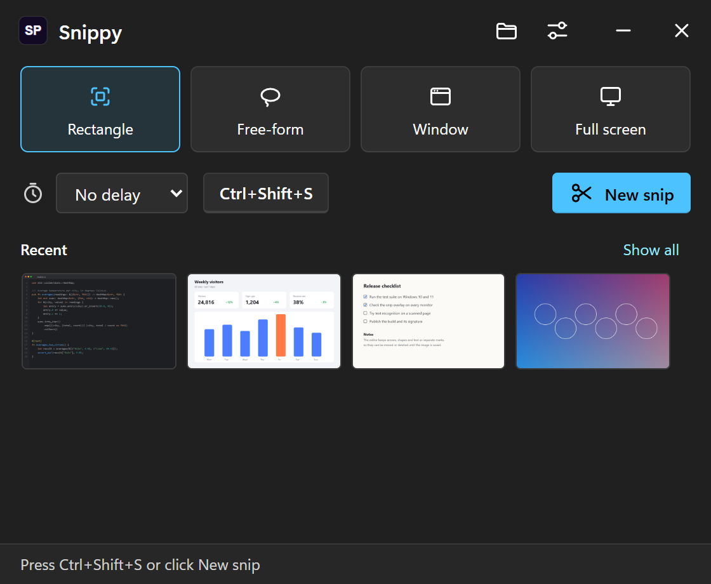
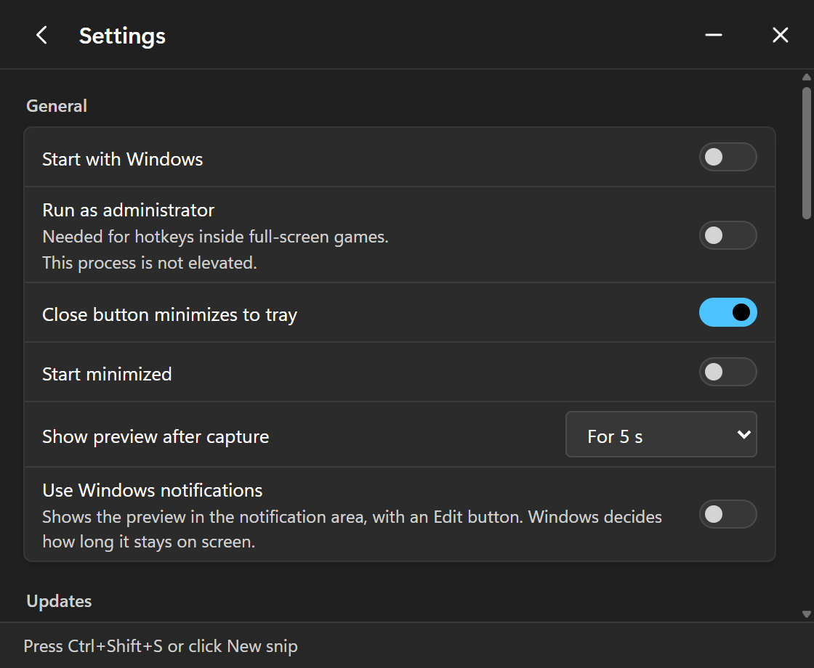
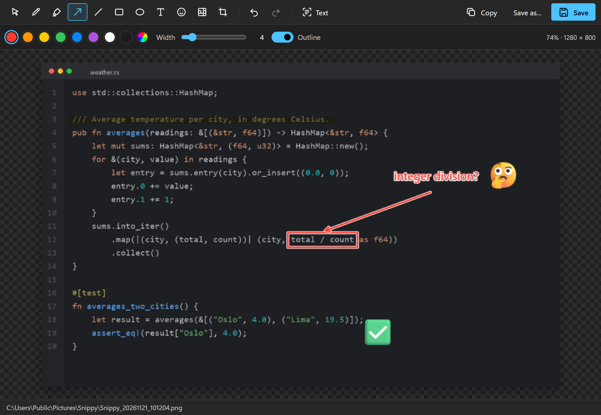
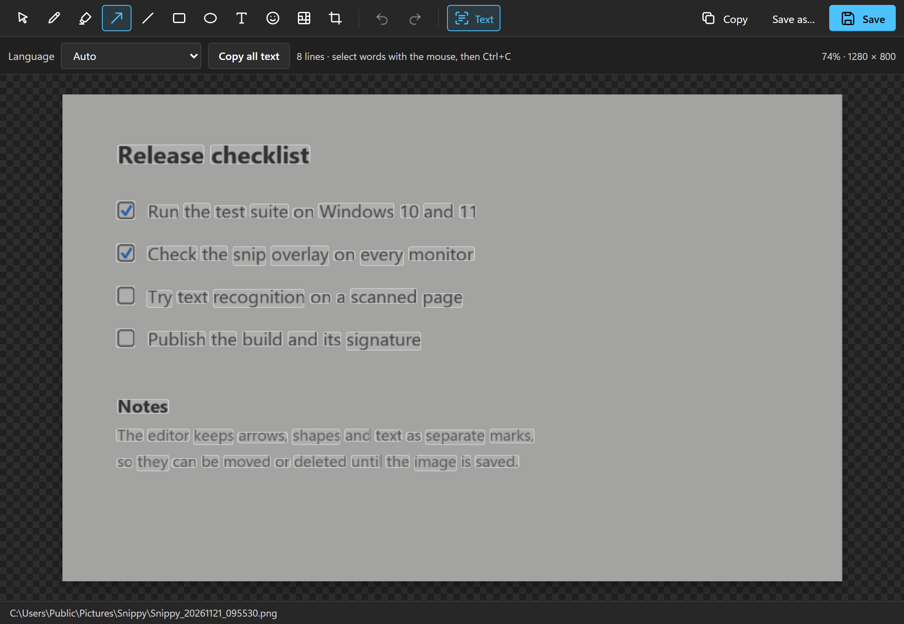

# Snippy

A portable screenshot tool for Windows 10 and 11: one `snippy.exe`, no installer.

- Rectangle, free-form, window and full-screen snips over a frozen copy of the screen, with a
  pixel magnifier and an optional delay
- Can take over **Win+Shift+S** and **Print Screen** from the built-in Snipping Tool
- Saves PNG or JPEG, copies to the clipboard, keeps a list of recent snips
- A short preview after each snip (3, 5 or 10 seconds, or off), or Windows notifications instead
- An editor: pen, highlighter, arrows, lines, shapes, text, emoji, pixelate, crop
- Text recognition with the OCR engine built into Windows; nothing is downloaded
- Updates itself from signed releases of this repository
- Dark theme, tray icon, optional snip sound, remembers which screen its window was on

<p align="center">
  
  
</p>



## Download

Get `snippy.exe` from the [latest release](https://github.com/copypastedusername/snippy/releases/latest), put it anywhere and run it.

It needs the Microsoft Edge WebView2 Runtime. Windows 11 has it and Windows 10 usually gets it with
Edge; on a trimmed Windows without it, Snippy says so and links to Microsoft's download page.

Settings live in `%APPDATA%\Snippy`, so they survive replacing or moving the exe. "Start with
Windows" remembers the exe's current path: after moving the exe, turn that option off and on again.

## Using Snippy

| Snip | Default hotkey |
|---|---|
| Rectangle | `Ctrl+Shift+S` |
| Free-form | `Ctrl+Shift+D` |
| Window | `Ctrl+Shift+W` |
| Full screen | `Ctrl+Shift+F` |

Hotkeys can be changed in Settings. A hotkey needs Ctrl, Shift or Alt, except F1–F24, Print Screen,
Pause and Scroll Lock, which may be used alone.

While choosing an area, `1`–`4` switch between rectangle, free-form, window and full-screen,
`Ctrl+A` selects the whole monitor in rectangle mode, `Enter` takes the snip, and `Escape` or a
right-click cancels. In window mode, `Tab` and `Shift+Tab` step through windows stacked under the
pointer. Hold `Alt` while dragging a rectangle to snap its sides to the nearest edges on
screen (window borders, buttons, the edge of a picture) within 10 pixels; a thin border line is taken
inside the snip, and sides with no clear edge nearby stay where you put them.

### Win+Shift+S and Print Screen

Settings → Windows shortcuts:

- **Win+Shift+S**: Windows sends this key to its default screen-capture app. Snippy registers as
  one; pick it once in Default apps (the settings page opens it and shows the steps). Where the key
  is free, as on some trimmed Windows builds, Snippy takes it directly.
- **Print Screen**: if Windows' own "Use the Print Screen key to open screen capture" is on, turn it
  off in Keyboard settings (the settings page links there). Alt+PrtScn and Win+PrtScn keep working
  as in Windows.
- **Use only these keys** turns off Snippy's own hotkeys.

### Editor

Open it with Edit in the preview, from a recent snip's context menu, or from a Windows
notification.

| Tool | Key | | Tool | Key |
|---|---|---|---|---|
| Select and move | `V` | | Ellipse | `E` |
| Pen | `P` | | Text | `T` |
| Highlighter | `H` | | Emoji | `M` |
| Arrow | `A` | | Pixelate | `B` |
| Line | `L` | | Crop | `C` |
| Rectangle | `R` | | Find text | `O` |

Shift keeps lines at 45° and shapes square; Outline adds a contrasting edge to arrows, lines,
shapes and text. Tool settings are remembered.



**Find text** reads everything the editor shows, your own marks included: select words with the
mouse and press `Ctrl+C`, or use Copy all text. Languages are the OCR languages installed in
Windows; "Auto" picks one that also reads Latin text.

`Ctrl+C` copies the image, `Ctrl+S` saves a copy next to the original, `Ctrl+Shift+S` saves as,
`Ctrl+Z` / `Ctrl+Y` undo and redo, `Ctrl` + mouse wheel zooms.

### Settings worth knowing

| Setting | What it does |
|---|---|
| Run as administrator | Keeps hotkeys working over elevated apps and full-screen games. With "Start with Windows" on, Snippy starts elevated silently; otherwise Windows asks every time. |
| Show preview after capture | How long the preview stays on screen: 3, 5 or 10 seconds, or off. |
| Use Windows notifications | Announces snips (and updates) as Windows notifications with Edit / Show in folder buttons. Windows decides how long they stay on screen. |
| File name pattern | Date and time tokens: `%Y` year, `%m` month, `%d` day, `%H` hour, `%M` minute, `%S` second. |
| Sound when snipping | Off by default. "Camera shutter" is built in; Click, High click, Tick and Ding are Windows' own UI sounds, re-pitched. Follows the "System sounds" volume. |
| Check for updates automatically | Checks at start and every few hours and offers a new version the same way snips are announced. |

The main window reopens where it was last, on the same screen; if that screen is gone, it opens in
the centre.

### Where Snippy keeps things

- `%APPDATA%\Snippy`: `config.json` and `logs`
- `%LOCALAPPDATA%\Snippy`: the WebView2 profile, the window position and the notification icon
- Snips go only to the folder chosen in Settings (by default `Pictures\Snippy`). Deleting a snip
  from Snippy moves it to the Recycle Bin. Removing Snippy's folders resets it and never touches
  saved snips.

## If Snippy does not start

Every launch writes what it is doing to `%APPDATA%\Snippy\logs\startup.log` (or
`%TEMP%\snippy-startup.log` when that folder cannot be written), line by line, so the file shows
the last step reached even when no window appears. Start `snippy.exe --debug` from a command prompt
to watch the same steps live in the console. A crash also writes `crash.log` next to it and shows a
message with the details.

Snippy itself handles the usual causes:

- **No or an old WebView2 Runtime.** Snippy needs Microsoft Edge WebView2 101 or later and offers
  the download page when it is missing or older.
- **A stuck earlier copy.** A new launch is handed to the running Snippy, which confirms it took
  it. If that copy does not confirm within 30 seconds, or is an older version that cannot take it,
  Snippy names the process and offers to close it.
- **Nothing for 30 seconds.** If the windows are not created by then, Snippy reports it instead of
  waiting forever.

If Windows blocks the exe before it runs ("Windows protected your PC"), choose More info → Run
anyway; Windows Security → Protection history shows whether Defender stopped it.

## Updates

Snippy checks the latest release of this repository. It offers the release when its version is
newer, or when the version is the same but the exe differs from the running one (compared by the
SHA-256 that GitHub reports), so a fix published without a new version number still reaches
everyone.

A release carries `snippy.exe` and `snippy.exe.sig`; the exe is installed only if its signature
matches the key compiled into Snippy, its hash matches the release, and its own version is the
offered one and not older than the running copy, so neither a tampered nor an older build is
accepted. Installing renames the running exe to `snippy.exe.old`, puts the new one
in its place and restarts; the new copy deletes the leftover. If the exe sits in a folder Snippy
cannot write to, it says so instead.

## Building from source

Requirements: Windows, a Rust toolchain matching `src-tauri/Cargo.toml`, and Node.js for the Tauri
CLI.

```powershell
npm install
npm run build
```

The result is `src-tauri\target\release\snippy.exe`. `npm run build` runs
`scripts/build-release.ps1`, which also strips the builder's local paths from the exe. The UI in
`ui` is plain HTML, CSS and JavaScript with no build step; Tauri compiles it into the exe.

For development:

```powershell
cd src-tauri
cargo run
cargo test
```

To keep build output on another drive, set `$env:CARGO_TARGET_DIR` before building.

### Repository layout

| Path | Purpose |
|---|---|
| `src-tauri/src/lib.rs` | Builds the app, owns shared state, registers commands and hotkeys. |
| `src-tauri/src/instances.rs` | One Snippy per session: hands later launches to the running copy, recovers from a stuck one. |
| `src-tauri/src/trace.rs` | The startup trace (`startup.log`, `--debug` console). |
| `src-tauri/src/crash.rs` | Crash and startup-timeout reports. |
| `src-tauri/src/capture.rs` | The snip workflow: grab, overlay handshake, save, copy, announce. |
| `src-tauri/src/screen.rs` | Captures the virtual desktop and lists monitors. |
| `src-tauri/src/winlist.rs` | Lists capturable windows and their bounds. |
| `src-tauri/src/overlay.rs` | Creates and controls the main, overlay and preview windows. |
| `src-tauri/src/placement.rs` | Remembers the main window's position and restores it on the same screen. |
| `src-tauri/src/editor.rs` | Editor window: the open image, export, save and copy. |
| `src-tauri/src/ocr.rs` | Text recognition with the OCR engine built into Windows. |
| `src-tauri/src/imageops.rs` | Crops images and encodes snips and thumbnails. |
| `src-tauri/src/storage.rs` | Saves, scans, validates, opens, reveals and recycles snip files. |
| `src-tauri/src/recents.rs` | Caches the newest snips of the output folder. |
| `src-tauri/src/clipboard.rs` | Copies images to the clipboard. |
| `src-tauri/src/shortcuts.rs` | Registers the global hotkeys. |
| `src-tauri/src/screenclip.rs` | Win+Shift+S / Print Screen integration and Windows' current settings. |
| `src-tauri/src/notify.rs` | Windows notifications and the `snippy://` links they open. |
| `src-tauri/src/updater.rs` | Update check, signature and version checks, in-place exe swap. |
| `src-tauri/src/sound.rs` | Optional snip sound. |
| `src-tauri/src/autostart.rs` | The "Start with Windows" logon task. |
| `src-tauri/src/elevation.rs` | Elevation detection and the UAC relaunch. |
| `src-tauri/src/config.rs` | Settings: defaults, validation, load and save. |
| `src-tauri/src/commands.rs` | The commands the UI calls. |
| `src-tauri/src/tray.rs` | Tray icon and menu. |
| `src-tauri/src/winreg.rs` | Small registry helpers (current user only). |
| `src-tauri/icons/icon.png` | Source of the app and tray icon; the other files in `icons/` are generated from it. |
| `ui/index.html`, `ui/scripts/main.js`, `ui/styles/main.css` | Main panel and settings. |
| `ui/overlay.html`, `ui/scripts/overlay.js`, `ui/styles/overlay.css` | The area-selection overlay. |
| `ui/scripts/snap.js` | Snapping a selection to edges in the frame (Alt while dragging). |
| `ui/flyout.html`, `ui/scripts/flyout.js`, `ui/styles/flyout.css` | The preview and update offer. |
| `ui/editor.html`, `ui/scripts/editor.js`, `ui/styles/editor.css` | The editor. |
| `ui/styles/theme.css` | Shared colours and controls. |
| `ui/scripts/ui-kit.js` | Icon helper and the context menu. |
| `ui/icons.svg` | UI icons, one `<symbol>` per glyph. |
| `scripts/build-release.ps1` | Release build (`npm run build`). |
| `docs/contract.md` | The contract between the Rust backend and the UI. |

UI icons sit on a 20×20 grid with a 1.5 px round stroke; add one as a new `<symbol id="…">` in
`ui/icons.svg` and use it with `<use href="icons.svg#name">` or `spriteIcon(name)`. After replacing
`src-tauri/icons/icon.png` (1024×1024), regenerate the other icons with
`npm run tauri -- icon src-tauri/icons/icon.png -o src-tauri/icons` and delete the `android` and
`ios` folders it also writes.

### Security notes

- The UI runs under a strict Content Security Policy: scripts only from the app, no inline scripts,
  images only from the app or `data:` thumbnails.
- File actions from the UI and from `snippy://` links accept only `.png`, `.jpg` and `.jpeg` files
  inside the configured output folder; paths are canonicalised before the check.
- Each window may call only the commands its page uses (`capabilities/*.json`, generated from the
  command list in `src-tauri/build.rs`); pages may listen for the backend's events but not send any.
- Registry writes go to the current user only. "Start with Windows" runs Snippy with the highest
  privileges only when "Run as administrator" is on; the task definition is written to a new file
  that stays locked against changes until Task Scheduler has read it.
- Updates are verified as described above before anything is replaced.
